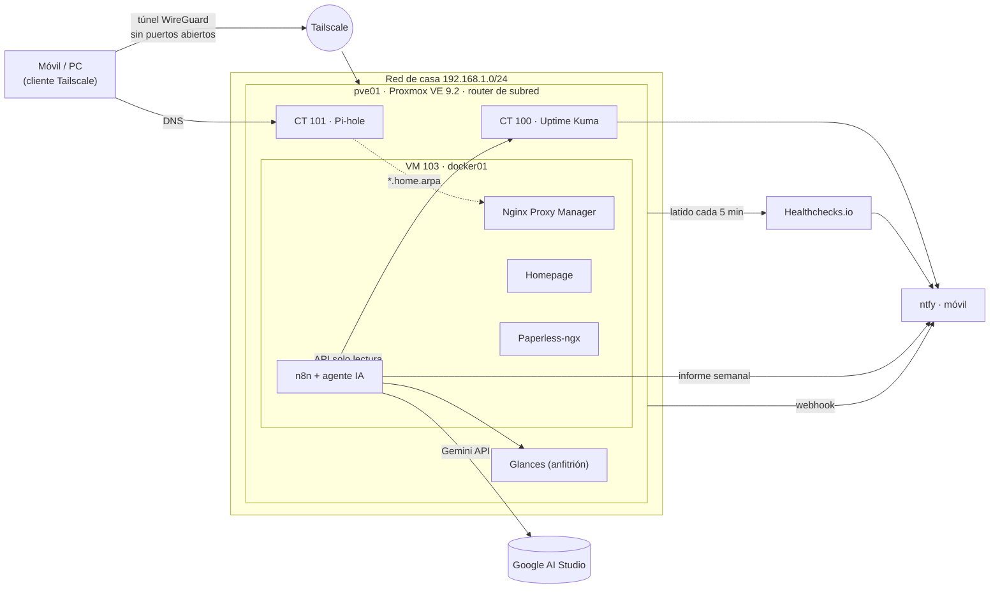

# Bastión — Lo construido hasta hoy

> Estado del proyecto a **09/11/2026**: qué hay montado, en qué orden se hizo y cómo se comprobó cada pieza.
> Documento público: no contiene contraseñas, tokens, claves, el nombre de la tailnet ni el tema de ntfy. Las IP que aparecen son privadas (RFC 1918).
> El detalle técnico vivo está en `inventario.md`; los problemas, en `incidencias.md`; lo que viene, en `plan-maestro.md`.

---

## En una frase

Un servidor físico de segunda mano (50 €) con Proxmox VE, sin ningún puerto abierto en el router, que ya tiene **DNS propio, acceso remoto seguro, monitorización, alertas al móvil, vigilancia externa, copias de seguridad probadas, una plataforma Docker endurecida, un panel de control y un agente de IA** que responde preguntas sobre la infraestructura en lenguaje natural. Todo documentado, incluidos 25 fallos reales y su solución.

## Mapa de capas

| Capa | Qué hay | Estado |
|---|---|---|
| Hardware | Dell OptiPlex 7020 (i5-4590, 16 GB, SSD 240 GB) validado con Memtest86+ y SMART | ✅ · ampliación a 24 GB + 2 discos recibida, sin montar |
| Hipervisor | Proxmox VE 9.2 en UEFI, repositorio sin suscripción, 2FA en todas las cuentas | ✅ |
| Acceso remoto | Tailscale como router de subred; ningún puerto abierto en casa | ✅ |
| DNS | Pi-hole (filtrado + nombres locales `*.home.arpa`) para la tailnet | ✅ |
| Monitorización | Uptime Kuma (10 monitores), Glances (hardware), Healthchecks.io (vigilante externo) | ✅ |
| Alertas | ntfy al móvil desde Proxmox, Kuma, Healthchecks y n8n | ✅ |
| Copias | Diarias de las 3 máquinas, restauración probada (incluida una VM con base de datos) | ✅ · falta la copia fuera de casa (3-2-1) |
| Plataforma | VM `docker01` endurecida con Docker Compose | ✅ |
| Servicios | Nginx Proxy Manager, Homepage, n8n, Paperless-ngx, GLPI (apagado a propósito) | ✅ |
| IA | Informe semanal con Gemini y agente de operaciones por chat | ✅ |
| Documentación | Inventario como fuente de verdad, 25 incidencias, memorias por fase | ✅ |

---

## 1. Antes del servidor: fases 1, 1b y 2 (octubre de 2026, Hyper-V)

Primer laboratorio dentro del PC de casa, que sirvió para aprender las bases y los errores que luego no se repitieron.

1. **Ubuntu Server en Hyper-V** con IP fija (netplan) y acceso remoto por Tailscale, sin abrir puertos.
2. **Endurecimiento:** SSH solo con clave Ed25519, UFW por servicio, Nginx accesible solo por el túnel, copias de configuración con cron y rotación de 7.
   - Lección clave (incidencia 7): en `sshd_config.d/` gana el **primer** archivo que define un valor. Se verifica siempre con `sshd -T`, no leyendo el archivo.
3. **Windows Server + Active Directory** (`lab.internal`): unidades organizativas propias, modelo AGDLP, doble cuenta (usuario y administrador) y GPO de prueba.
   - Lecciones (incidencias 9–11): nombre, IP y zona horaria **antes** de promover un controlador de dominio, y revisar los registros DNS antiguos al cambiar de IP. Por eso el DC **se reconstruirá desde cero** en Proxmox.

## 2. Servidor físico y Proxmox (30/10/2026)

1. **Compra:** Dell OptiPlex 7020 SFF de segunda mano por 50 €. Se eligió frente a un mini PC por relación precio/recursos.
2. **Validación antes de confiar en él:** Memtest86+ completo y SMART del SSD (26 588 horas, sin errores, desgaste 63).
3. **BIOS:** VT-x y VT-d activados, UEFI, Secure Boot desactivado, SATA en AHCI y **encendido automático tras un corte de luz** (AC Recovery = Power On).
4. **Instalación de Proxmox VE 9.2** en UEFI sobre ext4; repositorios *enterprise* desactivados y *no-subscription* activado.
5. **DNS del anfitrión:** 1.1.1.1 como principal. El router Movistar no responde como DNS (incidencia 13), y la regla es que la infraestructura base nunca depende de un DNS que ella misma aloja.
6. **Cuentas separadas:** `martin@pve` para el día a día y `root@pam` solo para emergencias, ambas con **2FA TOTP** y códigos de recuperación guardados fuera del servidor.

## 3. Acceso remoto sin puertos abiertos

1. **Tailscale en el anfitrión** como **router de subred** de `192.168.1.0/24`: desde el móvil se llega a cualquier máquina de casa como si estuviera en la red local.
2. Reenvío IP persistente en `/etc/sysctl.d/99-tailscale.conf` y ruta aprobada en la consola de Tailscale.
3. **DNS de la tailnet** apuntando a Pi-hole, para que los dispositivos con Tailscale usen los nombres `*.home.arpa` y el filtrado de anuncios.
4. **`accept-dns=false` en pve01** (incidencia 23): el servidor no usa el DNS de la tailnet, porque si cae Pi-hole el anfitrión se quedaría sin resolver nombres y sin poder enviar alertas.

## 4. Monitorización, alertas y vigilancia externa

1. **Uptime Kuma** en un contenedor LXC sin privilegios (CT 100), con 10 monitores: web y ping de Proxmox, salida a internet, DNS de Pi-hole, ping de docker01, paneles de NPM, Homepage, Paperless, n8n y la API de Glances. Los monitores de servicios apagados a propósito se pausan para no acostumbrarse a ver alertas en rojo.
2. **ntfy** como canal único de alertas al móvil. El tema se guarda como secreto, nunca en archivos ni en este repositorio.
3. **Notificaciones de Proxmox** (resultado de copias, salud de discos con smartd) mediante un destino *webhook* hacia ntfy. Cada vía de alerta se probó con un fallo real (incidencia 17).
4. **Healthchecks.io como vigilante externo:** pve01 envía una señal de vida cada 5 minutos por cron. Si cae el servidor, la luz o internet, el aviso lo da un servicio que no vive dentro de lo que vigila.
5. **Glances en el anfitrión** (solo API, escuchando solo en la IP de la red local), como servicio de systemd con `Restart=always`. Un contenedor no ve los sensores físicos, por eso va en pve01.
6. **Arranque automático** (`onboot=1`) en todas las máquinas, tras descubrir que un corte de luz las dejó paradas tres días (incidencia 23).

## 5. DNS propio con Pi-hole

1. **Contenedor LXC sin privilegios** (CT 101) con Pi-hole v6, solo para los dispositivos de la tailnet: el resto de la casa sigue con los DNS del proveedor, para no afectar a la familia.
2. **Listas de bloqueo:** StevenBlack + Hagezi Pro, unos 303 000 dominios.
3. **Nombres locales** en el dominio reservado `home.arpa`: `pve.home.arpa` va directo al servidor; los demás apuntan al proxy inverso.
4. **NTP de Pi-hole desactivado:** un contenedor sin privilegios comparte el reloj del anfitrión y no puede cambiarlo (incidencia 18).

## 6. Copias de seguridad

1. **Tarea diaria a las 03:30** en modo *snapshot* con compresión ZSTD.
2. **Restauración probada** de un contenedor y de una VM con base de datos: restaurada como VM 999 con la red desconectada (para evitar un conflicto de IP), comparando el número de tablas antes y después.
3. **Fallo detectado y corregido** (incidencia 24): la tarea solo copiaba una de las tres máquinas aunque decía "successful". Ahora copia las tres (≈ 6 GB por copia completa, 2 minutos).
4. **Retención calculada con el espacio real:** 3 diarias + 1 semanal mientras las copias vivan en el disco del sistema; 7 + 2 cuando pasen al disco de 2 TB.
5. **Pendiente:** la copia cifrada fuera de casa, que completa la regla 3-2-1 (ver `runbooks/01-copia-externa-rclone.md`).

## 7. Plataforma Docker: la VM `docker01`

1. **VM y no contenedor LXC:** Docker en un LXC comparte el núcleo con Proxmox; una VM aísla mejor.
2. **Hardware virtual:** 2 vCPU tipo `host`, 3 GB con *ballooning*, disco VirtIO SCSI con *discard* y *SSD emulation*, QEMU Guest Agent (necesario para copias coherentes).
3. **Debian 13 mínimo**, IP fija y DNS públicos. Tras cambiar la red se verifica después de un reinicio, no solo en caliente (incidencia 20).
4. **Endurecimiento SSH:** usuario sin privilegios con `sudo`, solo clave Ed25519 (una por equipo cliente, nunca copiadas entre equipos), sin acceso de root ni contraseñas, verificado con `sshd -T`.
5. **Docker Engine y Compose** desde el repositorio oficial de Docker.
6. **Convenciones:** un directorio por servicio en `/opt/<servicio>/` con su `compose.yaml`; secretos en `.env` con permisos 600; bases de datos sin puertos publicados y con versión fijada; instantánea de la VM en cada hito (`base`, `npm-ok`, `glpi-ok`, `paperless-ok`, `n8n-ok`).

## 8. Servicios

| Servicio | Para qué | Cómo se montó | Lección |
|---|---|---|---|
| **Nginx Proxy Manager** | Acceso por nombre (`kuma.home.arpa`…) sin recordar IP ni puertos | Proxy hosts por nombre, *websockets* donde hace falta, *Block Common Exploits*. Proxmox no pasa por el proxy (ya va por HTTPS) | Verificado con `curl -H "Host: …"`: el DNS apunta al proxy y el proxy decide el destino |
| **Homepage** | Panel de entrada diario, sobre todo desde el móvil | Widgets en vivo de Proxmox, Pi-hole, Kuma, Paperless y hardware (Glances), cada uno con su credencial de solo lectura. **Sin socket de Docker montado** | Mínimo privilegio también para los paneles; los enlaces usan nombres y las comprobaciones usan IP |
| **Paperless-ngx** | Gestión documental con OCR en español e inglés | Compose oficial con PostgreSQL 18 y Valkey, volúmenes con nombre | `run` crea un contenedor nuevo; `exec` entra en el existente (incidencia 22) |
| **GLPI** | Tickets e inventario (ITSM) | Imagen oficial + MariaDB 11.4 fijada, *healthcheck* antes de instalar | Comprobar el UID del contenedor antes de usar *bind mounts* (incidencia 21). **Apagado** mientras no se use |
| **n8n** | Automatización e IA | Contenedor con clave de cifrado propia, zona horaria de Madrid, vigilado por Kuma | Ver punto 9 |

## 9. Inteligencia artificial aplicada a la operación

1. **API de Gemini (Google AI Studio)** con límite de gasto y la regla de no enviar nunca datos personales ni secretos. Coste real: ≈ 1 céntimo por llamada.
2. **Informe semanal automático** (lunes 9:00): n8n consulta la API de Uptime Kuma, la API de Glances y las tareas de copia de Proxmox con un **token de solo lectura**; un nodo de JavaScript prepara los datos y Gemini redacta un resumen que llega por ntfy. El primero detectó por su cuenta el fallo de copias de la incidencia 24.
3. **Subflujo reutilizable** "Estado Bastión": la recogida de datos, mantenida en un solo sitio.
4. **Agente de operaciones por chat:** un *AI Agent* de n8n con Gemini y memoria de conversación, que decide qué herramienta usar según la pregunta:
   - `estado_general`: disponibilidad, hardware y copias.
   - `maquinas_proxmox`: estado y consumo de cada VM y contenedor.
   - Solo lectura por diseño: si se le pide reiniciar algo, se niega y propone el comando.
   - Accesible desde el móvil por Tailscale, con autenticación propia (incidencia 25).

## 10. Método de trabajo

1. **Inventario como fuente de verdad:** cada cambio de IP, servicio o configuración se refleja en el momento.
2. **Registro de incidencias** con formato fijo (síntoma → diagnóstico → causa → solución → aprendizaje): 25 hasta hoy.
3. **Cuatro reglas de diagnóstico:** leer la salida literal; escalera de red en orden (IP → puerta de enlace → internet por IP → DNS); verificar la configuración efectiva, no la escrita; los registros responden lo que la prueba funcional no.
4. **Reglas de la fase 3:** una alerta o copia que no se ha probado con un fallo real no está probada; el vigilante no vive dentro de lo que vigila; no se toca la red de un servidor en remoto sin una vía de emergencia.

---

## Deuda técnica conocida

| Pendiente | Por qué importa |
|---|---|
| Copia externa cifrada (3-2-1) | Hoy el servidor y sus copias están en el mismo SSD gastado |
| Tarea de copias en "Modo de selección: Todo" | Que las máquinas futuras entren solas |
| Sesión de hardware (24 GB, SSD para VM, HDD de 2 TB) | Memoria para el SOC y disco dedicado a copias |
| SSH de pve01 solo con clave | Hoy acepta contraseña de root |
| `mail-to-root` de Proxmox | Nunca ha entregado nada; quitarlo o usar un relay |
| Cambiar el tema de ntfy | Apareció en capturas de pantalla |
| docker01 al 89 % de memoria | Subir a 4 GB |
| Decidir el futuro de Paperless | En evaluación frente a Google Drive |
