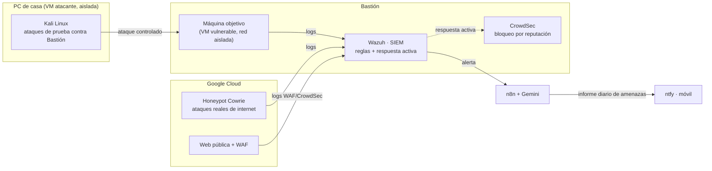

# Bastión — Plan maestro

> Hoja de ruta por fases del proyecto **Bastión**. Define qué se monta, cuándo, cuánto ocupa de recursos y crédito, cómo se hace migrable y cómo encaja con la nube y la web.
> Fecha: 10/11/2026. Se actualiza al cerrar cada fase.
> Principio rector: **infraestructura como código + Docker + todo en GitHub**, para que nada quede atado a un proveedor.

---

## 0. Las tres reglas del plan

1. **Todo migrable.** Cada servicio en Docker Compose; la configuración del servidor en Ansible; la creación de máquinas en la nube con Terraform cuando lo básico funcione. Así pasar de Google Cloud a Azure u Oracle es volver a aplicar los mismos archivos.
2. **La casa nunca se expone.** En el router de casa no se abre ningún puerto. Lo que deba estar en internet (web, honeypot) vive en la nube; lo de casa se alcanza por Tailscale. El honeypot va **aislado**, sin ruta hacia la red de casa.
3. **El crédito es un reloj.** Google Cloud son ~270 € para ~3 meses. Se aprovecha para lo que gana por estar fuera de casa, con alerta de presupuesto, y al terminar se migra a Oracle Always Free y se borra todo en Google.

---

## 1. Calendario general

| Fase | Nombre | Cuándo | Depende de |
|---|---|---|---|
| **A** | Cerrar la infraestructura (3-2-1, limpieza, GitHub) | Esta semana | — |
| **B** | Hardware: 24 GB + discos | Próxima visita a Yepes | Tener la sesión presencial |
| **C** | Base de automatización: Linux + Ansible | En paralelo con las clases | lab01 montado |
| **D** | Nube 1 — Web pública + dominio (Google Cloud) | Al activar el Student Pack (dominio) | Fase A |
| **E** | SOC: Wazuh + honeypot + ataques controlados | Tras la fase B (RAM) | 24 GB de RAM |
| **F** | Reconstrucción de Active Directory en Proxmox | Tras la fase B | 24 GB de RAM |
| **G** | Nube 2 — Laboratorios bajo demanda (Azure/AWS) | Antes de que caduque Google | Fase D probada |
| **H** | Migración a Oracle Always Free + cierre de Google | ~2 semanas antes de que caduque Google | Fase D |

Las fases C, D y E pueden solaparse: C es estudio diario, D es nube, E espera a la RAM.

---

## 2. Fase A — Cerrar la infraestructura (esta semana)

El objetivo es dejar la base "terminada" antes de construir encima. Son tareas cortas.

| Paso | Qué | Dónde está el detalle |
|---|---|---|
| A1 | **Copia cifrada a Google Drive con rclone** (completa la regla 3-2-1) | `runbooks/01-copia-externa-rclone.md` |
| A2 | Tarea de copias en **Modo de selección: Todo** | Inventario, sección 5 |
| A3 | Subir docker01 a **4 GB** de RAM (está al 89 %) | Proxmox → docker01 → Hardware |
| A4 | Decidir **Paperless**: integrarlo con Drive o apagarlo | Sección 7 de este plan |
| A5 | Endurecer el **SSH de pve01** (solo clave), con la consola web como emergencia; hacerlo en casa | Inventario, sección 5 |
| A6 | Quitar o arreglar `mail-to-root`; cambiar el tema de ntfy | Inventario, secciones 5 y 8 |
| A7 | **Subir Bastión a GitHub** con la estructura de este repositorio | Sección 9 |

**Regla 3-2-1 de copias:** 3 copias (la máquina viva + la copia local en Proxmox + la copia en Drive), en 2 soportes (SSD del servidor + nube), 1 fuera de casa (Drive cifrado). Con esto, un incendio, un robo o un ransomware en casa no se lleva los datos.

---

## 3. Fase B — Hardware (sesión presencial en Yepes)

Todo junto para abrir el equipo una sola vez. Está detallado en el contexto del proyecto; en resumen:

1. RAM a **24 GB** (quitar el módulo "Noname", un módulo de 8 por canal).
2. **Kingston A400** como LVM-Thin `vmdata` para los discos de las VM; mover ahí docker01.
3. **HDD de 2 TB** para las copias (volver la retención a 7 diarias + 2 semanales) y, más adelante, Jellyfin.
4. Pasta térmica, Memtest86+ y SMART largo del HDD.

Sin esta fase no hay memoria para Wazuh (5–7 GB), así que **la fase E depende de esta**.

---

## 4. Fase C — Automatización: Linux + Ansible

La base que hace que todo lo demás sea profesional y migrable.

1. **Clases de Linux** en `lab01` (las 12 del plan de contexto), escribiendo los comandos a mano.
2. **Ansible** en `ansible01`:
   - Inventario y claves → comandos *ad hoc* → playbook de actualizaciones → endurecimiento SSH con plantillas → roles y Vault → Windows/AD por WinRM.
   - **Todo en GitHub.** Un playbook `bootstrap` que deje una máquina nueva como docker01 (usuario, SSH endurecido, Docker, firewall) es la pieza que demuestra "sé automatizar", y es lo que luego se reutiliza en la nube.

Resultado para el portafolio: cualquier máquina de Bastión, en casa o en la nube, se levanta con los mismos playbooks.

---

## 5. Fase D — Nube 1: Web pública con tu dominio (Google Cloud)

El primer servicio **para otras personas** y la cara pública del proyecto.

### Qué se monta
- **VM pequeña en Google Cloud**, región Madrid (`europe-southwest1`), Debian, 2 vCPU y 4 GB. Coste orientativo 25–35 €/mes, dentro de los ~90 €/mes.
- **Sitio estático con Astro** (portafolio + blog + las 25 incidencias como bitácora pública), construido antes de tener el dominio y publicable ya en GitHub Pages.
- **Dominio del GitHub Student Pack** apuntado al sitio; HTTPS con Let's Encrypt por desafío DNS, sin abrir puertos.
- **Protección de la web:** Caddy o Nginx con **WAF** (reglas OWASP con Coraza/ModSecurity) y **CrowdSec**. La web pública aprende a defenderse y genera registros reales para el SOC.
- **La VM entra en la tailnet** para enviar sus registros a casa sin exponer nada.

### Por qué en la nube y no en casa
La web mira a internet. Si viviera en casa habría que exponer la red; en la nube, la casa sigue cerrada y, cuando caduque Google, el mismo Docker Compose se mueve a Oracle.

### Contenido del sitio (decisión tuya pendiente)
Qué datos de contacto aparecen. Recomendado: nombre, LinkedIn, GitHub y correo; sin teléfono ni dirección. Nada de IP internas, nombre de la tailnet ni temas de ntfy.

---

## 6. Fase E — SOC: detectar y responder a ataques

El corazón de ciberseguridad del proyecto, y lo más fuerte para el currículum. Es un laboratorio **defensivo**: se generan ataques contra tu propia infraestructura para comprobar que el SIEM los ve y que las defensas responden.



### Piezas
1. **Wazuh** (SIEM) en una VM de Bastión: recoge registros de las máquinas de casa, del honeypot de la nube y de la web. Reglas que convierten eventos en alertas. **Respuesta activa** para bloquear IP que repiten intentos.
2. **Máquina objetivo** en una **red aislada** de Proxmox (puente interno, sin salida a la red de casa): una VM con el agente de Wazuh donde probar detecciones.
3. **VM atacante (Kali)** en el PC de casa, también aislada, para lanzar pruebas controladas **solo contra tu propia máquina objetivo**: escaneos, intentos de acceso, un CVE conocido. El objetivo es ver cómo aparece en Wazuh y afinar las reglas.
4. **Honeypot Cowrie** en la nube: recibe ataques reales de internet y manda los registros a Wazuh. Material auténtico y vistoso.
5. **Informe diario de amenazas:** Wazuh → n8n → Gemini resume en lenguaje claro qué se intentó, desde dónde y qué se bloqueó → ntfy. Clasificado por táctica (marco MITRE ATT&CK).

### Reglas de seguridad de esta fase
- Todo el laboratorio ofensivo queda **dentro de redes aisladas**; la VM atacante solo llega a la máquina objetivo, nunca a la red de casa ni a internet como origen.
- El honeypot en la nube solo puede **enviar** registros a casa (por la tailnet), nunca iniciar conexiones hacia la red de casa.
- Se ataca **únicamente** infraestructura propia y de usar y tirar.
- Instantánea de la máquina objetivo antes de cada prueba, para restaurarla después.

### Encaje en memoria (24 GB)
Wazuh pide 5–7 GB, por eso espera a la fase B. Kali va en el PC, no en el servidor. La máquina objetivo y Cowrie son ligeras.

---

## 7. Fase F — Active Directory en Proxmox

Reconstruir desde cero (decisión ya tomada) el controlador de dominio `lab.internal` y un cliente Windows, en el orden correcto: nombre, IP y zona horaria **antes** de promover. Añadir `rocky-srv-01` unido al dominio para variedad (familia Red Hat, SELinux, firewalld). Es la base del laboratorio que luego se replica en **Azure con Entra ID** (fase G), el entorno que piden las multinacionales.

---

## 8. Fases G y H — Más nube y cierre

### G — Laboratorios bajo demanda (Azure for Students, AWS)
- **Azure for Students: 100 $, 12 meses** (confirmado hoy en la web de Microsoft; no es 1 mes). Incluye 750 h/mes de VM B1s gratis durante 12 meses. Encaja con el mundo Microsoft: **Entra ID**, Windows Server, un laboratorio de AD en la nube.
- **Regla:** estos laboratorios se encienden, se practican y se **apagan**. No se dejan corriendo.
- Al montarlos con los mismos Ansible/Terraform de Google, la migración es casi copiar y pegar: ese "moví cargas entre nubes con infraestructura como código" es oro en una entrevista.

### H — Migración a Oracle Always Free y cierre de Google
~2 semanas antes de que caduque Google (hay un recordatorio puesto):
1. Mover la web y la monitorización externa a **Oracle Always Free** (gratis permanente).
2. Copia de los datos importantes de la nube al homelab.
3. **Borrar todos los recursos de Google Cloud** para que no cobren al pasar a pago.

---

## 9. Paperless: la decisión de la fase A

No lo usas, pero antes de apagarlo, una integración que lo haría útil con lo que ya vas a montar (rclone):

- rclone sincroniza una carpeta de tu Drive (p. ej. "Escanear") con la carpeta *consume* de Paperless.
- Guardas desde el móvil en Drive como siempre; Paperless hace el OCR, lo clasifica y lo deja buscable en local.
- Drive es la puerta de entrada; Paperless, el archivo ordenado y con buscador.

Si aun así no le ves uso, se apaga como GLPI (`docker compose stop`) y se documenta. Ocupa memoria que el SOC va a necesitar.

---

## 10. Estructura del repositorio en GitHub

```
bastion/
├── README.md                 → portada: qué es, el diagrama, el estado
├── docs/
│   ├── 00-estado-actual.md    → lo construido paso a paso
│   ├── 01-inventario.md       → fuente de verdad (sin secretos)
│   ├── 03-incidencias.md      → los 25 fallos y su solución
│   ├── plan-maestro.md        → este documento
│   └── memorias/              → las memorias por fecha
├── runbooks/
│   └── 01-copia-externa-rclone.md
├── compose/                   → un compose.yaml por servicio (sin .env)
│   ├── npm/ homepage/ n8n/ paperless/ glpi/
├── ansible/                   → playbooks y roles (fase C)
├── terraform/                 → infraestructura de nube (fase D+)
└── .gitignore                 → excluye .env, claves, *.key, secretos
```

Regla de oro del repositorio: **nunca se sube un `.env`, una clave ni un token.** El `.gitignore` los excluye desde el primer *commit*. Lo que se sube son los `compose.yaml` con variables (`${VARIABLE}`), no los valores.

---

## 11. Seguimiento de progreso

El estado de cada fase se lleva en `docs/ROADMAP.md` con casillas, y cada hito cerrado se refleja aquí y en el inventario. Así el propio GitHub es la prueba del avance: *commits* fechados, incidencias resueltas y documentos que crecen.
