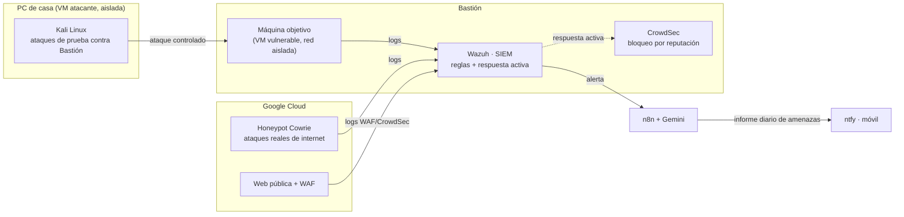

# Bastión — Plan maestro

> Hoja de ruta por fases del proyecto **Bastión**. Define qué se monta, cuándo, cuánto ocupa de recursos y crédito, cómo se hace migrable y cómo encaja con la nube y la web.
> Fecha: 16/11/2026. Se actualiza al cerrar cada fase.
> Principio rector: **infraestructura como código + Docker + todo en GitHub**, para que nada quede atado a un proveedor.

---

## 0. Las tres reglas del plan

1. **Todo migrable.** Cada servicio en Docker Compose; la configuración del servidor en Ansible; la creación de máquinas en la nube con Terraform cuando lo básico funcione. Así pasar de Google Cloud a Azure u Oracle es volver a aplicar los mismos archivos.
2. **La casa nunca se expone.** En el router de casa no se abre ningún puerto. Lo que deba estar en internet (web, honeypot) vive en la nube; lo de casa se alcanza por Tailscale. El honeypot va **aislado**, sin ruta hacia la red de casa. *Esta regla sigue vigente; la Fase I (sección 5 bis) estudia si se cambia y cómo, y no se toca nada antes de cerrarla.*
3. **El crédito es un reloj.** Google Cloud son ~270 € para ~3 meses. Se aprovecha para lo que gana por estar fuera de casa, con alerta de presupuesto, y al terminar se migra a Oracle Always Free y se borra todo en Google.

---

## Estado al 16/11/2026

| Fase | Estado |
|---|---|
| **A** | A1 (copia cifrada con rclone), A2 (copias en modo «Todo»), A3 (docker01 a 4 GB), A4 (Paperless apagado) y A6 (`mail-to-root` quitado) **hechos**. A5 (SSH solo con clave) **descartado por decisión**. Cambio del tema de ntfy **descartado por decisión**. A7 (Bastión en GitHub) **hecho**: la fase A queda **cerrada** |
| **B** | RAM a **24 GB hecha**. El Kingston A400 **ya no va al servidor**: se quita `vmdata` y los discos de las VM siguen en `local-lvm`. **Pendiente:** conectar el HDD de 2 TB |
| **C** | C1: el contenedor de prácticas `lab01` está creado y arrancado (con *nesting* activado); el estudio de Linux se hace con un curso. C2 y C3 (Ansible) pendientes |
| **D** | D1: proyecto de Google Cloud creado, con presupuesto de 90 €/mes y alertas al 50, 90 y 100 %; la vinculación de facturación espera la verificación de Google. D2: sitio Astro publicado en GitHub Pages con el dominio `martindeprada.dev` y HTTPS (fases 1, 2 y 2b de la web hechas). D3 y D5 pendientes |
| **I** | Nueva. Sin empezar. Es lo siguiente: desbloquea cómo se publican Estado e Incidencias en la web |
| **Servicios** | **GLPI** reactivado el 14/11 como fuente de las incidencias: 27 incidencias importadas por API más la 29 (la 28 está reservada). **Paperless** apagado de verdad (seguía encendido hasta el 13/11) |

---

## 1. Calendario general

| Fase | Nombre | Cuándo | Depende de |
|---|---|---|---|
| **A** | Cerrar la infraestructura (3-2-1, limpieza, GitHub) | ✅ Cerrada el 13/11/2026 (A5 descartado) | — |
| **B** | Hardware: 24 GB + HDD de 2 TB | RAM ✅ (16/11/2026); HDD en la próxima sesión presencial | Tener la sesión presencial |
| **C** | Base de automatización: Linux + Ansible | En paralelo con las clases | lab01 montado |
| **D** | Nube 1 — Web pública + dominio (Google Cloud) | Al activar el Student Pack (dominio) | Fase A |
| **I** | Publicar servicios: ¿abrir puertos o salir a la red? | Después de la web | Fase D (y conviene la E para vigilarlo) |
| **E** | SOC: Wazuh + honeypot + ataques controlados | Desbloqueada (RAM hecha) | 24 GB de RAM ✅ |
| **F** | Reconstrucción de Active Directory en Proxmox | Desbloqueada (RAM hecha) | 24 GB de RAM ✅ |
| **G** | Nube 2 — Laboratorios bajo demanda (Azure/AWS) | Antes de que caduque Google | Fase D probada |
| **H** | Migración a Oracle Always Free + cierre de Google | ~2 semanas antes de que caduque Google | Fase D |

Las fases C, D y E pueden solaparse: C es estudio diario, D es nube, E espera a la RAM.

---

## 2. Fase A — Cerrar la infraestructura (esta semana)

El objetivo es dejar la base "terminada" antes de construir encima. Son tareas cortas.

| Paso | Qué | Estado |
|---|---|---|
| A1 | **Copia cifrada a Google Drive con rclone** (completa la regla 3-2-1) | ✅ Hecho |
| A2 | Tarea de copias en **Modo de selección: Todo** (`all 1`) | ✅ Hecho |
| A3 | Subir docker01 a **4 GB** de RAM | ✅ Hecho |
| A4 | Decidir **Paperless**: apagado a propósito y retirado de Homepage/Kuma | ✅ Hecho |
| A5 | Endurecer el **SSH de pve01** (solo clave), con la consola web como emergencia; hacerlo en casa | ⏹️ Descartado por decisión (13/11/2026) |
| A6 | Quitar `mail-to-root` (tema de ntfy actual conservado por decisión) | ✅ Hecho |
| A7 | **Subir Bastión a GitHub** con la estructura de este repositorio | ✅ Hecho (13/11/2026) |

**Regla 3-2-1 de copias:** 3 copias (la máquina viva + la copia local en Proxmox + la copia en Drive), en 2 soportes (SSD del servidor + nube), 1 fuera de casa (Drive cifrado). Con esto, un incendio, un robo o un ransomware en casa no se lleva los datos.

---

## 3. Fase B — Hardware (sesión presencial en Yepes)

| Paso | Qué | Estado |
|---|---|---|
| B1 | RAM a **24 GB** (quitar el módulo "Noname", un módulo de 8 por canal) | ✅ Hecho (16/11/2026) |
| B2 | ~~**Kingston A400** como LVM-Thin `vmdata` para los discos de las VM; mover ahí docker01~~ | ⏹️ Descartado (16/11/2026): el Kingston no va al servidor. Se quita `vmdata`; los discos de las VM siguen en `local-lvm` (SSD del sistema) |
| B3 | **HDD de 2 TB** para las copias (volver la retención a 7 diarias + 2 semanales) y, más adelante, Jellyfin | ⏳ Pendiente de conectar |
| B4 | Pasta térmica, Memtest86+ y SMART largo del HDD | ⏳ El SMART largo va con B3 |

Con la RAM hecha ya hay memoria para Wazuh (5–7 GB): **la fase E queda desbloqueada**. Lo que falta de esta fase (el HDD) solo afecta a las copias.

> Los runbooks que usan `vmdata` (`03-hardware.md`, `04-linux-y-ansible.md`, `06-soc-wazuh.md`, `07-active-directory.md`) deben pasar a `local-lvm`.

---

## 4. Fase C — Automatización: Linux + Ansible

La base que hace que todo lo demás sea profesional y migrable.

**Estado (14/11/2026):** `lab01` creado (CT 102, Debian 13, sin privilegios, *nesting* activado) y arrancado. El estudio de Linux se hace con un curso; `lab01` es el campo de pruebas. Ansible, pendiente.

1. **Clases de Linux** en `lab01` (las 12 del plan de contexto), escribiendo los comandos a mano.
2. **Ansible** en `ansible01`:
   - Inventario y claves → comandos *ad hoc* → playbook de actualizaciones → endurecimiento SSH con plantillas → roles y Vault → Windows/AD por WinRM.
   - **Todo en GitHub.** Un playbook `bootstrap` que deje una máquina nueva como docker01 (usuario, SSH endurecido, Docker, firewall) es la pieza que demuestra "sé automatizar", y es lo que luego se reutiliza en la nube.

Resultado para el portafolio: cualquier máquina de Bastión, en casa o en la nube, se levanta con los mismos playbooks.

---

## 5. Fase D — Nube 1: Web pública con tu dominio (Google Cloud)

El primer servicio **para otras personas** y la cara pública del proyecto.

### Qué se monta
- **VM pequeña en Google Cloud**, región Madrid (`europe-southwest1`), Debian, 2 vCPU y 4 GB. Coste orientativo 25–35 €/mes, dentro de los ~90 €/mes.
- **Sitio estático con Astro** (portafolio + blog + las incidencias como bitácora pública), construido antes de tener el dominio y publicable ya en GitHub Pages.
- **Dominio del GitHub Student Pack** apuntado al sitio; HTTPS con Let's Encrypt por desafío DNS, sin abrir puertos.
- **Protección de la web:** Caddy o Nginx con **WAF** (reglas OWASP con Coraza/ModSecurity) y **CrowdSec**. La web pública aprende a defenderse y genera registros reales para el SOC.
- **La VM entra en la tailnet** para enviar sus registros a casa sin exponer nada.

### Por qué en la nube y no en casa
La web mira a internet. Si viviera en casa habría que exponer la red; en la nube, la casa sigue cerrada y, cuando caduque Google, el mismo Docker Compose se mueve a Oracle.

### Contenido del sitio (decisión tuya pendiente)
Qué datos de contacto aparecen. Recomendado: nombre, LinkedIn, GitHub y correo; sin teléfono ni dirección. Nada de IP internas, nombre de la tailnet ni temas de ntfy.

---

## 5 bis. Fase I — Publicar servicios: ¿abrir puertos o salir a la red?

Se hace **después de la web (fase D)**. Hoy la decisión vigente es que en casa no se abre ningún puerto y que lo público vive en la nube. Esta fase no la cambia: sirve para **estudiar con criterios** qué pasaría si se quisiera publicar algo desde Bastión (o dar acceso desde fuera sin Tailscale), cómo se haría de forma segura y **qué cambiaría en la web**. Solo si el resultado lo justifica se modifica la decisión, y se documenta.

### Opciones a comparar

| Opción | Cómo funciona | Riesgo y coste |
|---|---|---|
| **1. Seguir cerrado** (decisión actual) | Lo público va a la VM de la nube; lo de casa, solo por Tailscale | Riesgo mínimo. La nube consume crédito hasta migrar a Oracle |
| **2. Salir en vez de entrar** | Túnel saliente desde Bastión (Cloudflare Tunnel o Tailscale Funnel): no se abre ningún puerto en el router, pero el tráfico pasa por un tercero | Riesgo medio. Hay que proteger la aplicación con control de acceso y depender del proveedor |
| **3. Abrir puertos 80/443** | Reenvío en el router hacia un proxy inverso en una zona aislada (DMZ) con WAF y CrowdSec | Riesgo alto y más mantenimiento. Exige segmentar la red, vigilar con el SOC y comprobar que el operador permite puertos entrantes y cómo se trata la IP dinámica |

### Qué hay que decidir y documentar
1. Qué servicio concreto se publicaría y por qué no puede ir a la nube.
2. Tabla de decisión: riesgo, coste, mantenimiento y qué demuestra cada opción en el portafolio.
3. Si se abre algo: **zona aislada** sin ruta hacia la red de casa; proxy inverso con WAF (reglas OWASP) y CrowdSec; HTTPS; actualizaciones; monitorización en Kuma; y una **vía de emergencia** antes de tocar el router (regla ya existente: no cambiar la red en remoto sin ella).
4. **Prueba de concepto** con un servicio de usar y tirar, y, si la fase E está lista, un ataque controlado para ver que Wazuh lo detecta.
5. Un plan de vuelta atrás: poder cerrar todo de inmediato.

### Qué cambia en la web (martindeprada.dev)
- **Dónde se aloja:** hoy es estático en GitHub Pages. Según la opción: seguir en Pages, moverlo a la VM de la nube con Caddy (cabeceras CSP/HSTS) o servirlo desde Bastión por túnel.
- **Despliegue:** el flujo de GitHub Actions cambia (de publicar en Pages a copiar la carpeta `dist/` al servidor o construir un contenedor), y se añade un monitor en Uptime Kuma.
- **Una sola variable:** `SITE_URL` en `astro.config.mjs`, más el DNS del dominio.
- **Contenido que deja de ser cierto si se abre algo:** la cifra «0 puertos abiertos» (inicio, Bastión, README y CV), el diagrama de arquitectura y la decisión de diseño «ningún puerto abierto en el router de casa». Hay que actualizarlos a la vez y explicar el porqué en la bitácora.

### Cuándo está terminada
Con la decisión escrita (aunque sea «seguimos cerrados»), la prueba de concepto hecha o descartada con motivo, y la web, el CV y el inventario coherentes con el resultado.

---

## 6. Fase E — SOC: detectar y responder a ataques

El corazón de ciberseguridad del proyecto, y lo más fuerte para el currículum. Es un laboratorio **defensivo**: se generan ataques contra tu propia infraestructura para comprobar que el SIEM los ve y que las defensas responden.



### Piezas
1. **Wazuh** (SIEM) en una VM de Bastión: recoge registros de las máquinas de casa, del honeypot de la nube y de la web. Reglas que convierten eventos en alertas. **Respuesta activa** para bloquear IP que repiten intentos.
2. **Máquina objetivo** en una **red aislada** de Proxmox (puente interno, sin salida a la red de casa): una VM con el agente de Wazuh donde probar detecciones.
3. **VM atacante (Kali)** en el PC de casa, también aislada, para lanzar pruebas controladas **solo contra tu propia máquina objetivo**: escaneos, intentos de acceso, un CVE conocido. El objetivo es ver cómo aparece en Wazuh y afinar las reglas.
4. **Honeypot Cowrie** en la nube: recibe ataques reales de internet y manda los registros a Wazuh. Material auténtico y vistoso.
5. **Informe diario de amenazas:** Wazuh → n8n → Gemini resume en lenguaje claro qué se intentó, desde dónde y qué se bloqueó → ntfy. Clasificado por táctica (marco MITRE ATT&CK).

### Reglas de seguridad de esta fase
- Todo el laboratorio ofensivo queda **dentro de redes aisladas**; la VM atacante solo llega a la máquina objetivo, nunca a la red de casa ni a internet como origen.
- El honeypot en la nube solo puede **enviar** registros a casa (por la tailnet), nunca iniciar conexiones hacia la red de casa.
- Se ataca **únicamente** infraestructura propia y de usar y tirar.
- Instantánea de la máquina objetivo antes de cada prueba, para restaurarla después.

### Encaje en memoria (24 GB)
Wazuh pide 5–7 GB; con la RAM ya en 24 GB (fase B1) cabe. Sin `vmdata`, sus discos van en `local-lvm`, así que hay que vigilar el espacio del SSD del sistema. Kali va en el PC, no en el servidor. La máquina objetivo y Cowrie son ligeras.

---

## 7. Fase F — Active Directory en Proxmox

Reconstruir desde cero (decisión ya tomada) el controlador de dominio `lab.internal` y un cliente Windows, en el orden correcto: nombre, IP y zona horaria **antes** de promover. Añadir `rocky-srv-01` unido al dominio para variedad (familia Red Hat, SELinux, firewalld). Es la base del laboratorio que luego se replica en **Azure con Entra ID** (fase G), el entorno que piden las multinacionales.

---

## 8. Fases G y H — Más nube y cierre

### G — Laboratorios bajo demanda (Azure for Students, AWS)
- **Azure for Students: 100 $, 12 meses** (confirmado hoy en la web de Microsoft; no es 1 mes). Incluye 750 h/mes de VM B1s gratis durante 12 meses. Encaja con el mundo Microsoft: **Entra ID**, Windows Server, un laboratorio de AD en la nube.
- **Regla:** estos laboratorios se encienden, se practican y se **apagan**. No se dejan corriendo.
- Al montarlos con los mismos Ansible/Terraform de Google, la migración es casi copiar y pegar: ese "moví cargas entre nubes con infraestructura como código" es oro en una entrevista.

### H — Migración a Oracle Always Free y cierre de Google
~2 semanas antes de que caduque Google (hay un recordatorio puesto):
1. Mover la web y la monitorización externa a **Oracle Always Free** (gratis permanente).
2. Copia de los datos importantes de la nube al homelab.
3. **Borrar todos los recursos de Google Cloud** para que no cobren al pasar a pago.

---

## 9. Paperless: decisión tomada en la fase A

Se decidió **apagarlo** (`docker compose stop`) igual que GLPI, conservando sus volúmenes y configuración, pausando su monitor en Uptime Kuma y comentando su bloque en `services.yaml` de Homepage para ahorrar memoria RAM de cara al SOC.

**Corrección (14/11/2026):** al revisar `docker01` se comprobó que Paperless seguía encendido (tres contenedores, unos 770 MB). Se apagó entonces de verdad y la memoria disponible pasó de 2,1 GB a 2,7 GB.

**GLPI vuelve a estar encendido** desde el 14/11/2026, porque pasa a ser la fuente real del registro de incidencias. Cabe en memoria con Paperless apagado. Se tomó una instantánea de la VM antes de reactivarlo y otra antes de importar las incidencias.

---

## 10. Estructura del repositorio en GitHub

```
bastion/
├── README.md                 → portada: qué es, el diagrama, el estado
├── docs/
│   ├── 00-estado-actual.md    → lo construido paso a paso
│   ├── 01-inventario.md       → fuente de verdad (sin secretos)
│   ├── 03-incidencias.md      → los 27 fallos y su solución
│   ├── plan-maestro.md        → este documento
│   ├── bitacora.md            → diario de cambios fechado
│   └── memorias/              → las memorias por fecha
├── runbooks/
│   └── 01-copia-externa-rclone.md
├── compose/                   → un compose.yaml por servicio (sin .env)
│   ├── npm/ homepage/ n8n/ paperless/ glpi/
├── ansible/                   → playbooks y roles (fase C)
├── terraform/                 → infraestructura de nube (fase D+)
└── .gitignore                 → excluye .env, claves, *.key, secretos
```

Regla de oro del repositorio: **nunca se sube un `.env`, una clave ni un token.** El `.gitignore` los excluye desde el primer *commit*. Lo que se sube son los `compose.yaml` con variables (`${VARIABLE}`), no los valores.

---

## 11. Seguimiento de progreso

El estado de cada fase se lleva en `docs/ROADMAP.md` con casillas, y cada hito cerrado se refleja aquí y en el inventario. Así el propio GitHub es la prueba del avance: *commits* fechados, incidencias resueltas y documentos que crecen.

---

## 12. GLPI como fuente de las incidencias

**Decisión:** GLPI es la fuente real del registro de incidencias. El archivo `docs/03-incidencias.md` sigue en el repositorio como copia versionada y se mantiene al día.

**Hecho (14/11/2026):**
- GLPI 12.0.1 reactivado en `docker01` y API legacy activada, con un cliente de API limitado a la IP interna de Docker.
- Las 27 incidencias existentes importadas con un script en Python (`importar_incidencias.py`) que lee el archivo del repositorio y crea un ticket por incidencia, en estado Cerrado. El script es una prueba en seco por defecto, guarda qué incidencias ya subió y no duplica.
- Incidencia 29 creada con el mismo procedimiento. La 28 queda reservada para el caso de verificación de Google Cloud.

**Cómo se crea una incidencia nueva:** se añade al archivo del repositorio, se copia a `docker01` y se ejecuta el script con `--only N --apply`.

**Pendiente:**
1. Criterio de **publicable** en GLPI (por ejemplo, una categoría que se asigna solo tras revisar el ticket).
2. Flujo **GLPI → n8n → web**: n8n lee solo los tickets publicables, los sanea y los publica hacia fuera. Solo tráfico saliente.
3. Esperar a la **Fase I**: de ella depende dónde y cómo se publican Estado e Incidencias.

---

## 13. Registro de cambios

| Fecha | Cambio |
|---|---|
| 13/11/2026 | Fase A cerrada: copia cifrada a Drive, copias en modo «Todo», `docker01` a 4 GB, `mail-to-root` quitado, A5 descartado por decisión. Repositorio renombrado a `bastion` y publicado. Fase I añadida al plan |
| 13/11/2026 | `lab01` creado (CT 102) y arrancado, con *nesting* activado |
| 14/11/2026 | Paperless apagado de verdad. GLPI reactivado. 27 incidencias importadas a GLPI por API. Incidencia 29 registrada |
| 16/11/2026 | Fase B: RAM a 24 GB hecha. El Kingston ya no va al servidor (se quita `vmdata`). Pendiente conectar el HDD de 2 TB. Fases E y F desbloqueadas |

